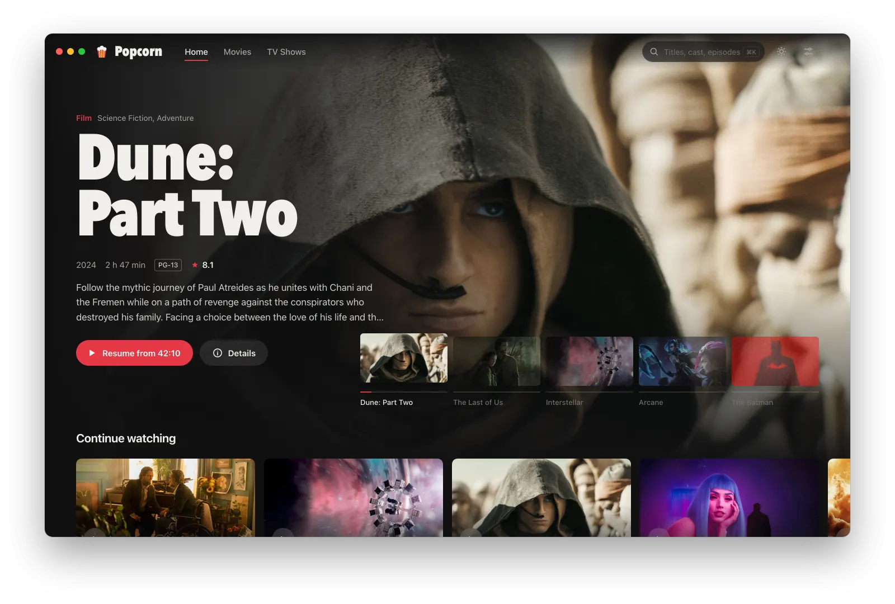
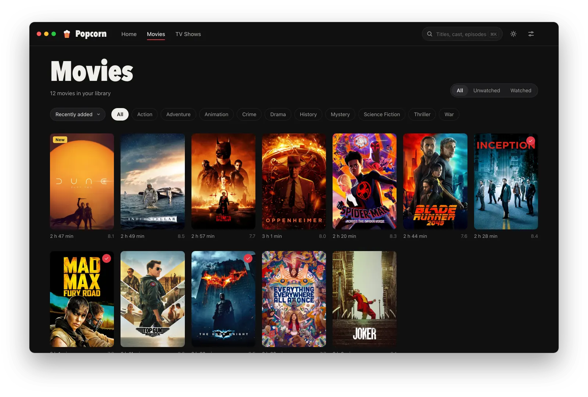
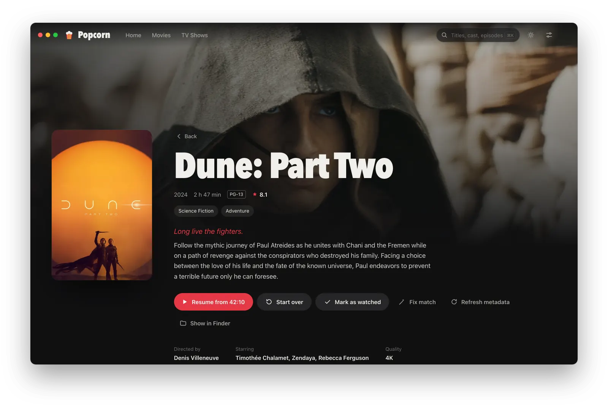
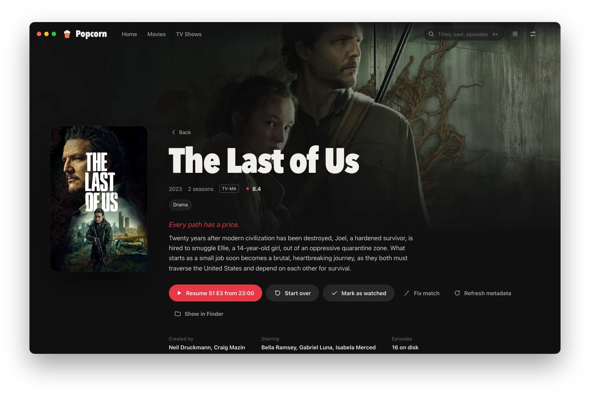
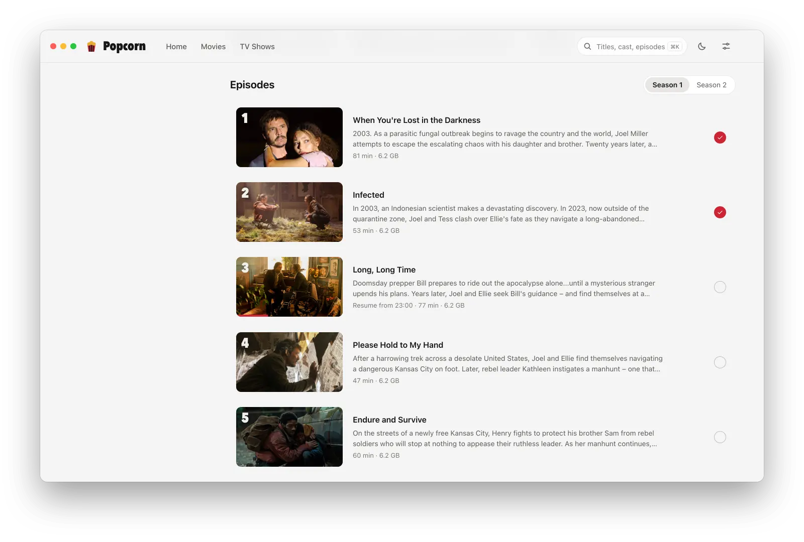
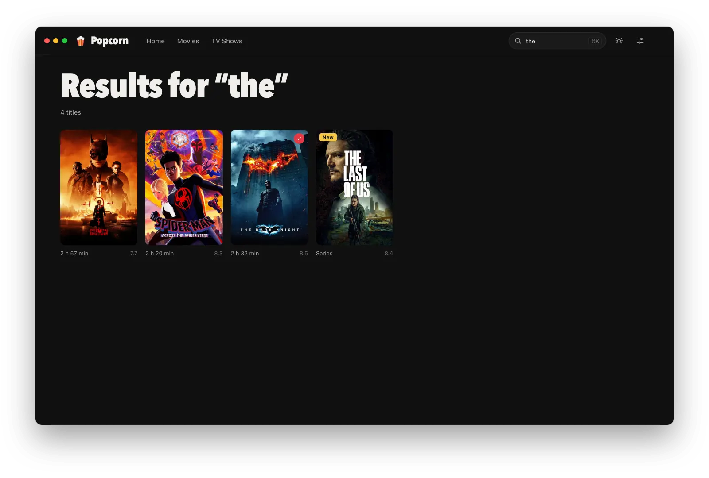
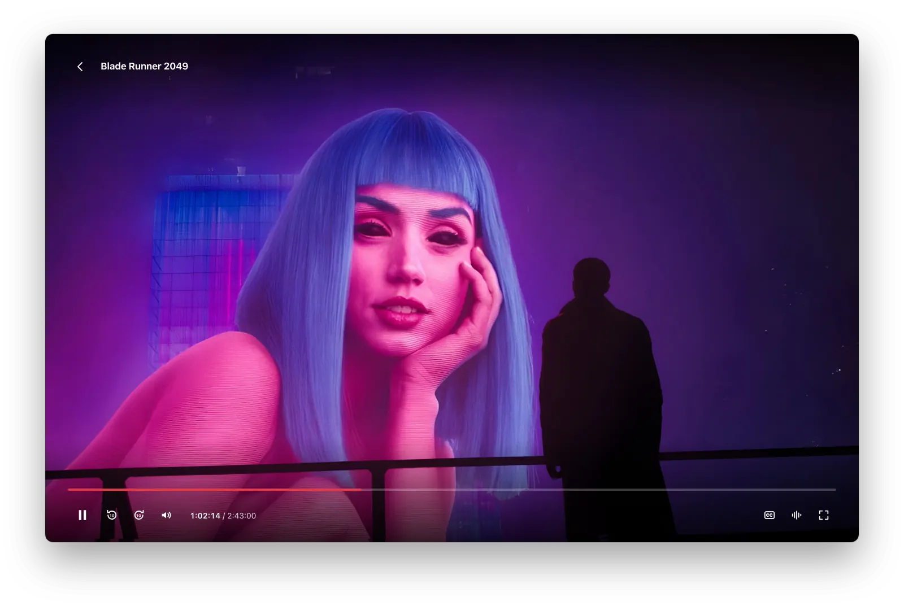

<div align="center">


# Popcorn

**Your own movie and TV folder, turned into a streaming-style library.**

A small, free and open-source macOS app that finds the movies and shows on your Mac,
adds posters and details, and plays them in a built-in player.

[](https://github.com/dizzpy/Popcorn/releases/latest)


[](LICENSE)

</div>

<p align="center">
  <picture>
    <source media="(prefers-color-scheme: light)" srcset="docs/images/home-light.webp" />
    
  </picture>
</p>

## Why "Popcorn"?

Because that's what you grab before you press play. Popcorn is meant to be just as simple: point it
at a folder, and your movie night is ready. No account, no server, no subscription.

## Features

- **A library that builds itself.** Pick a folder and Popcorn finds every movie and episode,
  groups episodes into shows and seasons, and keeps watching the folder for new files.
- **Posters, cast and details** from [TMDB](https://www.themoviedb.org): artwork, ratings,
  genres, overview, director and cast, plus episode names and stills.
- **Built-in player.** Plays almost any format (MKV, MP4, AVI, HEVC, AV1, 4K, HDR…) right inside
  the app, with audio track and subtitle switching.
- **Picks up where you left off.** Continue watching, resume times, "play next episode", and
  automatic watched ticks.
- **Fast search** across titles, cast and episode names.
- **Dark and light themes.**
- **Your files stay untouched.** Popcorn never copies, moves, renames or deletes anything.
- **Works offline.** After the first metadata download, the library works without internet.
- **Small and light.** Native app under 50 MB, no Electron, no background services.

## Screenshots

| | |
|:---:|:---:|
|  |  |
| **Movies**, with sorting and genre filters | **Movie details**, with resume and Fix match |
|  |  |
| **TV shows**, with "resume S1 E3" | **Episodes** by season (light theme) |
|  |  |
| **Search** with <kbd>⌘</kbd> <kbd>K</kbd> | **Player**, with subtitles and audio tracks |

## Download and install

1. Download the latest `Popcorn_x.y.z_aarch64.dmg` from
   [**Releases**](https://github.com/dizzpy/Popcorn/releases/latest).
2. Open the DMG and drag **Popcorn** into **Applications**.
3. **First launch:** Popcorn isn't signed with an Apple developer certificate yet, so macOS will
   warn you. **Right-click the app → Open**, then confirm. On macOS 15 and newer, if that isn't
   offered, go to **System Settings → Privacy & Security** and click **Open Anyway**.

Requires a Mac with Apple Silicon (M1 or newer) and macOS 13 Ventura or later.

## How to use

### 1. Choose your media folder

On first launch, pick the folder that holds your movies and shows. It can be on an external
drive. Popcorn scans it and keeps it in sync as you add or remove files.

### 2. Add a free TMDB key (for posters and details)

1. Create a free account at <https://www.themoviedb.org>.
2. Open **Settings → API** on the TMDB site and request a free key.
3. Paste either the **API Key** or the **API Read Access Token** into Popcorn.

Your key stays on your Mac. Without one, Popcorn still works, just without artwork.

### 3. Name your files so Popcorn can recognize them

Popcorn understands most common naming styles, including release names like
`Dune.Part.Two.2024.2160p.WEB-DL.mkv`. These layouts work best:

```text
Movies/
  Dune Part Two (2024).mkv
  Interstellar (2014)/Interstellar.2014.1080p.mkv

TV Shows/
  The Last of Us/
    Season 1/
      The Last of Us S01E01.mkv
      The.Last.of.Us.1x02.mkv
    Season 2/
      Episode 1.mkv
```

- Put the **year** in movie names when you can. It makes matching much more accurate.
- Episodes are recognized from `S01E02`, `1x02`, or a `Season 1` folder with numbered files.
- Subtitle files next to the video with a similar name (`.srt`, `.ass`, `.ssa`, `.vtt`) load
  automatically. You can also add one from the player.
- Supported video files: `mkv mp4 m4v mov avi webm ts m2ts wmv flv mpg mpeg`.

If a title gets matched to the wrong movie or show, open it and use **Fix match** to pick the
right one.

### 4. Watch

Click any title and press **Play**. Popcorn remembers where you stopped once you've watched more
than a minute, and marks a title as watched at 90%. You can also mark titles watched or unwatched
yourself.

### Keyboard shortcuts

**Anywhere**

| Key | Action |
|---|---|
| <kbd>⌘</kbd> <kbd>K</kbd>, <kbd>⌘</kbd> <kbd>F</kbd> or <kbd>/</kbd> | Search |
| <kbd>⌘</kbd> <kbd>[</kbd> | Go back |
| <kbd>Esc</kbd> | Close search / go back |
| Arrow keys | Move between posters |

**In the player**

| Key | Action |
|---|---|
| <kbd>Space</kbd> | Play / pause |
| <kbd>←</kbd> <kbd>→</kbd> | Back / forward 10 seconds (hold <kbd>Shift</kbd> for 60) |
| <kbd>↑</kbd> <kbd>↓</kbd> | Volume up / down |
| <kbd>M</kbd> | Mute |
| <kbd>F</kbd> | Fullscreen |
| <kbd>S</kbd> | Next subtitle track |
| <kbd>A</kbd> | Next audio track |
| <kbd>N</kbd> | Next episode |
| <kbd>Esc</kbd> | Exit fullscreen / close the player |

## Privacy

Popcorn has no accounts, analytics or tracking. The only network requests go to TMDB to look up
titles and download artwork. Your library, watch progress and TMDB key are stored only on your
Mac, in `~/Library/Application Support/Popcorn/`.

## Contributing and feedback

Found a bug, a file that isn't recognized, or have an idea?
[Open an issue](https://github.com/dizzpy/Popcorn/issues/new/choose). Contributions are welcome:
see [CONTRIBUTING.md](CONTRIBUTING.md) to get started, and [CHANGELOG.md](CHANGELOG.md) for
what's new in each version.

Please report security problems privately, as described in [SECURITY.md](SECURITY.md).

---

## For developers

<details open>
<summary><b>Contents</b></summary>

- [Tech stack](#tech-stack)
- [Project structure](#project-structure)
- [Building from source](#building-from-source)
- [Checks](#checks)
- [Packaging a release](#packaging-a-release)
- [Changing colors](#changing-colors)
- [Further docs](#further-docs)

</details>

### Tech stack

| Layer | Choice |
|---|---|
| App shell | [Tauri 2](https://tauri.app) (Rust) |
| UI | Plain HTML, CSS and vanilla JavaScript (ES modules). No framework, bundler or npm. |
| Video | [libmpv](https://mpv.io), embedded in the main window, built slim from pinned sources |
| Database | SQLite via `rusqlite` (bundled) |
| Metadata | TMDB API over `ureq` with rustls |
| File watching | `notify` with FSEvents |

Target: macOS 13+ on Apple Silicon (`aarch64-apple-darwin`). Platform code is kept behind
`#[cfg(target_os = "macos")]` so other platforms can be added later.

### Project structure

```text
src-tauri/            Rust app
  src/
    commands.rs       Tauri commands called by the UI
    db/               SQLite schema, migrations and queries
    library/          file name parsing, grouping, scanning, watching, search
    tmdb/             TMDB client, matching, metadata, image cache, fetch queue
    player/           libmpv bindings, embedding in the window, playback session
    progress.rs       resume points and watched state
  capabilities/       which commands the window may call
  tauri.conf.json     app config, including the Content Security Policy
ui/                   the interface (served from disk, no build step)
  css/tokens.css      every color in the app
  js/views/           screens (home, movies, shows, details, search, player, settings)
  js/components/      shared pieces (poster grid, hero, rows, toasts…)
scripts/              libmpv build, dylib bundling, packaging and checks
docs/                 API contract, third-party licenses, README images
```

### Building from source

Requirements: Xcode Command Line Tools, Rust (stable) and the Tauri CLI.

```sh
cargo install tauri-cli --version "^2" --locked
cargo tauri dev
```

Video playback needs a slim libmpv, built from pinned and checksummed sources into `build/`.
No Homebrew libraries are linked. The first build takes a few minutes:

```sh
brew install meson ninja pkgconf   # build tools only
scripts/build-libmpv.sh
```

In development, point the app at that library (otherwise a Homebrew `mpv`, if installed, is used):

```sh
POPCORN_LIBMPV="$PWD/build/prefix/lib/libmpv.2.dylib" cargo tauri dev
```

### Checks

```sh
cd src-tauri
cargo fmt --check
cargo clippy --all-targets -- -D warnings
cargo test
```

`scripts/check-colors.sh` fails if a color is written anywhere outside `ui/css/tokens.css`.

### Packaging a release

```sh
scripts/package.sh
```

This builds `Popcorn.app` and the DMG with libmpv bundled inside, and fails if the app is over
50 MB. The results are in `src-tauri/target/aarch64-apple-darwin/release/bundle/`. Use this script
rather than `cargo tauri build` alone, which does not bundle libmpv.

Pushing a `v*` tag runs [`.github/workflows/release.yml`](.github/workflows/release.yml), which
tests, builds the DMG and attaches it to a GitHub release. Signing and notarization run only when
the `APPLE_*` repository secrets are set.

### Changing colors

Every color in the interface is a token in [ui/css/tokens.css](ui/css/tokens.css). Edit a base
color there and every solid and transparent shade follows. If you change the dark `--c-velvet`,
also change `backgroundColor` in `src-tauri/tauri.conf.json`.

### Further docs

- [docs/API.md](docs/API.md): the commands and events between the UI and Rust
- [docs/THIRD_PARTY.md](docs/THIRD_PARTY.md): bundled components, their licenses and sources
- [CONTRIBUTING.md](CONTRIBUTING.md): development setup, code guidelines and pull requests

## License

Popcorn is released under the [GPL-3.0](LICENSE) license.

This product uses the TMDB API but is not endorsed or certified by TMDB. Movie and show artwork in
the screenshots comes from TMDB and belongs to its respective owners.
